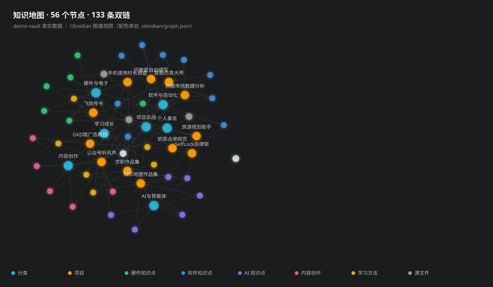

# 🗺️ 个人知识地图 · Portfolio

> 把 1386 份散落文件，变成一张 AI 智能体查得到的"外置大脑"。

我是**听风声**，一名在校大学生。这里公开我的 Obsidian 知识地图方法论、真实项目成果卡，以及一个可以让 AI 帮你自动搭建同款知识地图的 **AI Skill**。

> **关键词**：Obsidian 知识地图 · 第二大脑（Second Brain）· PKM 个人知识管理 · 知识图谱 · 双链笔记 · AI Agent 上下文记忆 · 知识库搭建教程 · 大学生项目作品集 ｜ Obsidian knowledge map · knowledge graph · AI agent memory · note-taking workflow


## 📸 效果一览（我的真实界面）

**总览仪表盘**——132 个节点、7 个一级分类，点卡片就能一层层往里进：


**图谱视图**——方法和能力被多个项目复用的关系，一眼可见：


> 🛠️ 想要同款？跟着 [tutorial/保姆级搭建教程.md](tutorial/保姆级搭建教程.md) 1 小时复刻（含国内加速下载）。

## 🎬 示例库图谱（可以直接下载体验）

下图是 [`demo-vault/`](demo-vault/使用说明.md) 的**真实渲染**——**56 个节点、133 条双链**，结构与我的真实库一致（内容已脱敏）：



颜色按层级区分：🔵 分类 ｜ 🟠 项目 ｜ 🟢🔷🟣 各领域知识点 ｜ ⚪ 源文件指路牌。
下载后装 Obsidian 打开，按 `Ctrl+G` 看到的可交互版本就是这个。

## 📊 数字一览

| 指标 | 数值 |
|---|---|
| 索引的源文件 | 1386 份 |
| 知识节点 | 132 个 |
| 一级分类 | 7 个 |
| 结构层数 | 4 层（分类 → 项目集 → 知识点 → 源文件路径） |

## 🧠 这套系统能干什么

- **防失忆**：AI 干活前先查地图，直接继承全部上下文，不用从头复述
- **省 token**：先看 132 个节点的目录，再按需打开文件，不全量喂给 AI
- **可导航**：四层面包屑定位，最后一层直接给出文件在本机的真实路径
- **能纠错**：图谱可视化能逐层点开检查，断链、过期路径肉眼可见
- **经验复用**：每完成一件事沉淀一个节点，方法论越滚越大

## 📁 目录导航

```
├── tutorial/      保姆级搭建教程：1 小时从零复刻（含截图 + 国内加速下载）
├── methodology/   方法论：怎么搭、怎么维护（人看的教程）
├── projects/      成果卡：我用这套系统管理的真实项目
├── demo-vault/    示例库：56 个节点的完整知识地图，Obsidian 打开即 1:1 体验同款画面
├── ai-skill/      AI Skill + 万能提示词：让 AI 帮你自动搭同款
└── assets/        图片素材
```

## 🚀 快速开始

- **零基础复刻同款** → 跟 [tutorial/保姆级搭建教程.md](tutorial/保姆级搭建教程.md)（1 小时，含截图）
- 只想看懂原理 → 读 [methodology/知识地图方法论.md](methodology/知识地图方法论.md)
- 用智能体干活 → 装 [ai-skill/SKILL.md](ai-skill/SKILL.md)
- 用网页版 ChatGPT → 复制 [ai-skill/知识地图搭建提示词.md](ai-skill/知识地图搭建提示词.md)
- **想 1:1 体验同款画面** → 下载 [demo-vault/](demo-vault/使用说明.md) 文件夹（**7 分类 · 12 项目 · 32 知识点 · 56 节点**），装 [Obsidian](https://obsidian.md)（免费）后「打开本地仓库文件夹」，按 `Ctrl+G` 直接看图谱效果

## 📮 找到我

- 微信公众号：**听风声**（每周更新 AI / 效率工具干货）

---

⭐ 如果这套方法对你有帮助，点个 Star 就是对我最大的鼓励！
