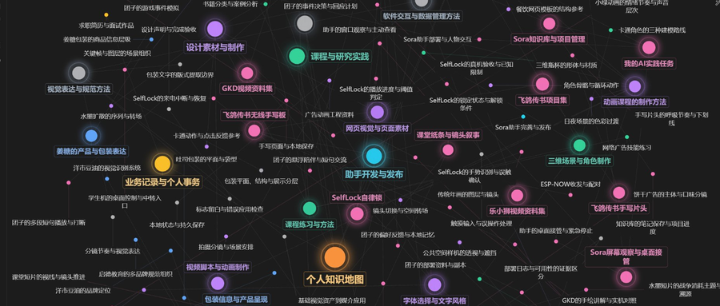

# 飞鸽传书：双板同步手写板

> 两块 7 寸触摸屏，你在 A 板写字，B 板实时同步出现——教室里的离线"传纸条"系统。

## 一、问题

- 教室场景不方便用手机传消息，纸质传纸条效率低
- 市面平板方案贵，且需要网络

## 二、判断

选择 **2 × ESP32-8048S070C（7 寸电容触摸屏）+ ESP-NOW 协议**：

- ESP-NOW 是乐鑫的私有无线协议，**无需路由器、无需联网**，点对点延迟极低
- 成本可控（两块屏含配件约 ¥355），远低于两台平板
- 触摸驱动 + LVGL 式自绘 UI，可实现"黑底荧光绿笔迹"的草稿纸伪装界面

## 三、动手

- **双板同步固件（sync_board70.ino）**：A 板采集触摸轨迹 → 拆分成笔画点序列 → ESP-NOW 广播 → B 板重绘
- **双缓冲渲染**：绘制层与显示层分离，避免快速书写时闪屏撕裂
- **笔灵敏度调优**：针对小字密集书写场景调整采样滤波，防窥视场景下手感不能糊
- 配件链路：无源盘式电容笔 + 绘画手套 + LiPo 电池 + TP4056 充电模块

## 四、验证

- 两板 CH340 驱动识别正常（COM 口随 USB 口变化的问题已定位并记录在知识地图）
- 屏幕触摸全绿（所有触点响应正常）
- 同步书写延迟达到"跟手"水平，小字书写不丢点

## 五、沉淀（可复用经验）

1. ESP-NOW 配对与收发是通用的，可平移到其他双机联动项目
2. "双缓冲"思想适用于所有带屏设备 UI
3. USB 串口不稳定时，先怀疑端口漂移而不是驱动损坏

---
状态：🚧 固件迭代中（v2.5 双缓冲）　|　技术栈：ESP32 / Arduino / ESP-NOW / 触摸驱动　|　周期：2026-09 至今
