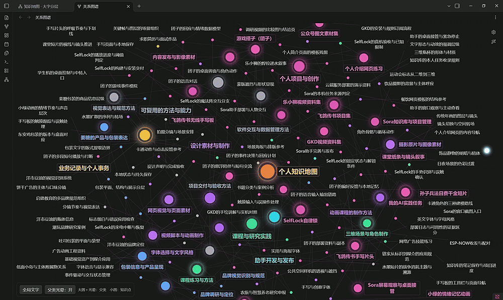
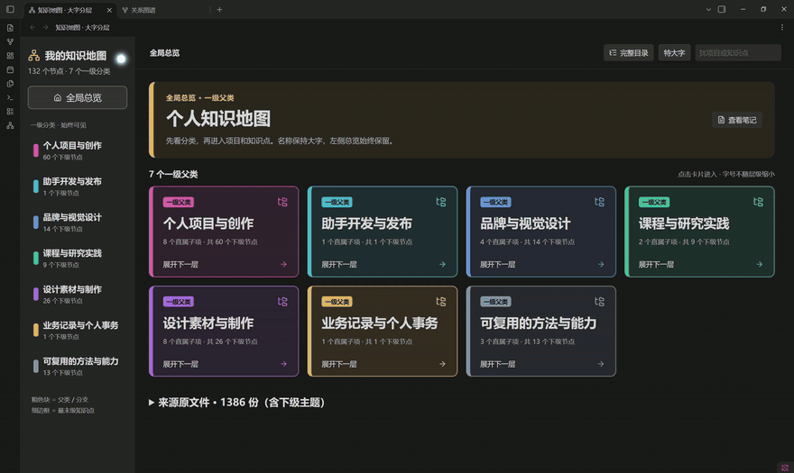
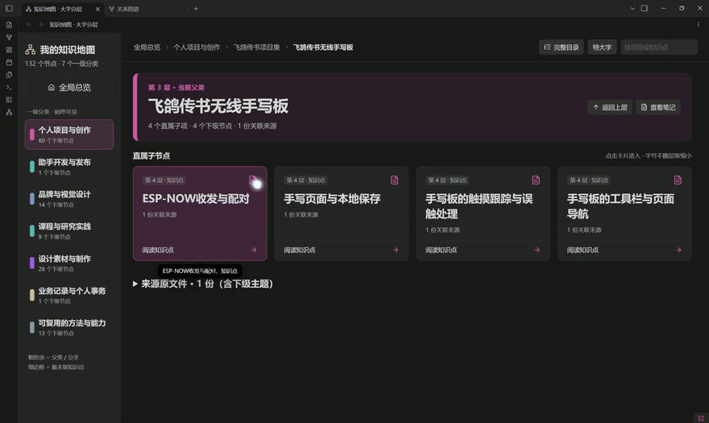

# 🛠️ 保姆级搭建教程：从零做出你自己的知识地图

> 全程约 1 小时（一大半在等 Obsidian 安装包下载），不需要编程基础。走完你拿到的是**属于你自己的**知识地图，不是别人的样板。

## 最终效果（先看，再动手）

## 🕸️ 图谱视图

### 所有笔记的关系网，颜色按层级自动分组



## 📊 第 1~2 层 · 分类 → 项目

### 打开库第一眼：132 个节点、7 个一级分类。点卡片就能一层层往里进，越深的层卡片越小



## 📂 第 3~4 层 · 知识点 → 源文件

### 点知识点卡 → 最深一层登记真实文件路径，一键定位



> 💡 库一共**四层**（分类 → 项目 → 知识点 → 源文件），后两段动图正好从头走到尾。三张都是**动图**（亮着的圆点就是鼠标），加载需要一两秒，稍等。

---

## 🧭 先确认走法（30 秒）

本教程默认你要的是**成品**：用 AI 把你自己的文件夹变成知识地图，四步走完。

| 你的目标 | 怎么走 |
|---|---|
| **想要一套自己的知识地图**（绝大多数人） | 从 **第 1 步** 一路走到第 6 步，这就是主线 |
| 只想先看看长什么样，还没决定要不要建 | 先看文末 **附录 A**（30 秒，装个样板间），看完再回来走主线 |
| 想亲手摸清四层结构 | 第 2 步里的 **备选 2 · 纯手动**（选做，5 分钟） |

主线就四件事：**装 Obsidian → 让 AI 给你建库 → 打开看效果 → 以后一句话维护**。

## 第 1 步 · 下载安装 Obsidian（10~30 分钟，大头是等下载）

1. 打开官网 [obsidian.md](https://obsidian.md)，点 **Get Obsidian for Windows** 下载（Windows 安装包约 330 MB）
2. 下载慢？直接用这条**国内加速直链**复制到浏览器地址栏（实测 20 分钟左右下完）：

   ```
   https://gh-proxy.com/https://github.com/obsidianmd/obsidian-releases/releases/download/v1.14.5/Obsidian-1.14.5.exe
   ```

   上面挂了就换备用：在原链接前加 `https://ghfast.top/`。通用规则：**任何 GitHub 下载链接，前面拼上加速前缀就能直连加速**（版本号旧一点没关系，能装就能用）。

3. 双击安装，一路下一步
4. 装好桌面会出现这个紫色宝石图标：


> 💡 Obsidian 对个人使用**完全免费**，笔记都是本地 `.md` 纯文本，永远不会被锁在软件里。

## 第 2 步 · 用 Codex 搭你自己的库（20 分钟 · 主线）

关键点：**Obsidian 库的本质就是一堆 `.md` 文件**——AI 能写文件，就等于能替你建库，你一个字都不用敲。

先决定库放哪：桌面新建一个文件夹，比如 `我的知识库`。**空的没关系**，笔记是 AI 写出来的。

### 主线 · 在 Codex 里搭（这套地图就是这么做出来的）

> 📌 事实先摆清：**这张 132 节点、索引 1386 份文件的知识地图，全部内容都是在 Codex 里写出来的**，没有别的工具参与。下面就是把当时的过程重走一遍。

> ✅ **前提检查（10 秒）**：Codex 要付费套餐（Plus 及以上）才稳定可用，免费号只在限时活动时偶尔开放。打开 Codex，能新建任务就按主线走；用不了就先等等限时活动，或看看下面的备选。

1. 打开 Codex → 新建任务
2. **让它扫描你的硬盘**：一句话说清扫哪里、你想管什么，比如「扫描我 D 盘的智能作业文件夹，把里面的项目整理成知识库」。文件夹结构、文件清单都不用你准备，它自己遍历
3. 贴上 [ai-skill/知识地图搭建提示词.md](../ai-skill/知识地图搭建提示词.md)，让它按四层结构输出：`00-总览` → 分类 → 项目卡 → 知识点 → 源文件登记
4. **等它生成知识库**，然后你来做质检：翻一遍生成的库，看有没有漏掉的项目、文件——发现了就对它说「把 XX 也收进知识库」「这个分类少了源文件登记」，让它补进去
5. 查漏补完、内容没问题了，用 Obsidian 打开它（第 3 步）

> 💡 扫描大文件夹要等几分钟，正常。第一次可以先让它扫一个小文件夹跑通流程，再扫全盘。

### 备选 1 · 装在本机的 AI 助手

如果你本机装了能读写文件的 AI 助手（WorkBuddy、Claude Code 这类），可以让它扫描硬盘后直接往库文件夹里写 `.md`；配上 [ai-skill/SKILL.md](../ai-skill/SKILL.md)，以后还能让它按同一套规矩维护。

> 🤝 说明一下：作者的库不是通过这个途径建出来的，所以这条路的细节我还没来得及实战验证。**如果你用这条路时遇到了问题，欢迎开 Issue 反馈，我会在 GitHub 上及时回复；skill 有做得不对的地方，我也会第一时间修正。** 大家提的每一条意见，都会进入我的「记忆飞轮」——你踩过的坑会被写进 skill，让后面的人走得更顺。

### 备选 2 · 纯手动（选做，5 分钟吃透结构）

不推荐当主线，但手动跑通一次最小模板，你能真正理解四层怎么咬合——以后检查 AI 的产出也心里有数。新建空库照抄：

```markdown
# 分类名

## 项目列表（第 2 层）

- [[你的项目名]]
```

```markdown
# 项目名

> 一句话讲清这是什么。

## 用到的知识点

- [[知识点A]]
- [[知识点B]]
```

```markdown
# 知识点名

## 结论
（只记结论和踩坑，细节放外链）

## 被谁使用
（不用写，反向链接面板自动生成）
```

三条铁律（**AI 建库时也会自动遵守**——它们已写进 skill）：
1. **每条笔记必须有 `[[链接]]`**，不允许孤岛
2. **单个分类超过 ~80 个节点就拆分**，否则总览层会退化成新的混乱
3. **源文件路径变了当场改**，过期路径比没有路径更害人

## 第 3 步 · 用 Obsidian 打开你的库（30 秒）

1. 打开 Obsidian → 点 **打开本地仓库文件夹**（Open folder as vault）
2. 选中刚建好的库文件夹（如 `我的知识库`）→ 打开
3. 看到 AI 生成的总览笔记（`00-总览` 或类似名字）就成功了，点进去能一路点到底

> 🎨 **可选：想要截图里那套绿色主题？**（不做也完全不影响功能）
> AI 新建的库是白底默认样式。想要同款绿系画面 + 图谱配色，把 **附录 A** 样板间里的隐藏文件夹 `.obsidian` 整个复制到你自己的库根目录，重开 Obsidian 就生效。

## 第 4 步 · 打开图谱，看懂颜色（1 分钟）

1. 左侧栏点**图谱视图**图标（三个圆连线的那个）
2. 颜色含义：
   - 🔵 **青色** = 分类（第 1 层）
   - 🟠 **橙色** = 项目（第 2 层）
   - 🟢 **绿色** = 知识点（第 3 层）
3. 鼠标悬停任意节点，与它相连的笔记会高亮——这就是「双向链接」的可视化

> 刚建好的库节点少、图比较稀，这是正常的。**笔记越多、链接越密，图才越像封面那张蜘蛛网。**

## 第 5 步 · 理解四层结构（重要，3 分钟）

打开你库里的总览笔记，顺着链接走一圈，你会发现所有笔记都长在这棵树上：

| 层 | 是什么 | 示例 |
|---|---|---|
| 1 | 分类 | 项目实战 |
| 2 | 项目卡 | 飞鸽传书 |
| 3 | 知识点 | ESP-NOW 双板通信 |
| 4 | 源文件登记 | 真实文件路径表 |

**核心心法：笔记是入口，最后一层永远指向真实文件。** 这样隔一个月回来，从任意笔记 3 次点击内到达源码。

> 想拿一个"标准答案"对照着看？文末 **附录 A** 的样板间就是严格照这个结构搭的，结构对不对，一比就知道。

## 第 6 步 · 日常维护也交给 AI

建好只是开始，完全体是"越用越聪明"。但先分清两件事，别白操心：

| 谁干 | 干什么 | 需要你/我操心吗 |
|---|---|---|
| **Obsidian 自动** | 索引、双链、反向链接、图谱、搜索——文件一改它自己重算 | ❌ 永远不用管，也不用叫 AI 去"扫描" |
| **AI 才要干** | 往库里**写/改 `.md` 的内容**：新项目建档、登记源文件路径、拆分膨胀分类 | ✅ 一句话指挥它 |

所以"让 AI 更新"不是让它去刷新索引，而是让它**生产内容**——Obsidian 发现文件变了，自动把新链接画进图谱。

维护全是嘴里一句话，不用手动：

- 每次干完活：「把这次的新项目补进『项目实战』分类，并更新源文件登记」
- 某个分类太挤：「这个分类超 80 个节点了，帮我拆分」
- 文件挪了位置：「同步更新源文件登记，清掉断链」

> 💡 维护和建库是一个道理：每隔一两周，让 Codex「重新扫描一遍，看看有没有漏掉的新项目、新文件，补进知识库」——它扫完生成，你花两分钟检查一遍有没有错漏，跟你建库时的质检步骤一样。

## 附录 A · 只想先试试水？30 秒看样板间

> 🔖 这一节是**可选支线**，跳过不影响主线，装/不装 demo 和装 skill **不冲突**——demo 是个 Obsidian 库文件夹（给眼睛看的样板间），skill 是给 AI 的说明书，一个躺在 Obsidian 库列表，一个躺在 AI 技能目录，互不相干。
>
> 三种人适合看这一节：① 还没决定要不要搭，想先看效果；② 想知道四层结构到底长什么样；③ 想要第 3 步里那套绿色主题配置。

**① 下载**

1. 打开**本仓库的页面**：浏览器地址栏输入 `github.com/wind-04300/knowledge-map-portfolio`
   （⚠️ 注意：这是"仓库页面"，不是你的 GitHub 个人主页——绿色 Code 按钮只在仓库页面里，个人主页上没有）
2. 点绿色 **Code** 按钮 → **Download ZIP**
3. 解压，找到 `demo-vault` 文件夹（**整个文件夹**都要，包括里面隐藏的 `.obsidian` 配置——画面同款全靠它）
4. 记住这个文件夹的位置

> 🐢 如果 GitHub 下载慢：在 **Download ZIP** 按钮上**右键 → 复制链接**，然后在该链接前面拼上 `https://gh-proxy.com/` 再用浏览器打开，即可加速下载（和第 1 步装 Obsidian 的加速原理相同）。

**② 用 Obsidian 打开它**

1. 打开 Obsidian → 点 **打开本地仓库文件夹**（Open folder as vault）
2. 选中 `demo-vault` 文件夹 → 打开
3. 看到「00-总览」就成功了——绿色主题、图谱分组已经内置，**零配置**

**③ 看完想删就删**

Obsidian 左下角库图标 → **管理库** → 移除这个库，或直接把 `demo-vault` 文件夹删掉。**你自己的库完全不受影响**，两者就是两个独立文件夹。

## 常见问题

**Q：`打开本地仓库文件夹` 找不到我的文件夹？**
弹窗里直接粘贴路径最稳，别一层层点。

**Q：图谱打开是空的？**
说明笔记之间还没有 `[[链接]]`——让 AI「补齐笔记间的双链」，或回第 2 步备选 2 手动补。

**Q：手机上能用吗？**
分手机说：

- **安卓（vivo / OPPO / 小米等都行）**：能，而且**不用应用商店、不用翻墙**。安卓版不在国内商店上架，官方给的是 APK 直装文件（托管在 GitHub）——用第 1 步教过的加速前缀就行。把这条复制到**手机浏览器**地址栏下载（仅 14.5 MB，几分钟下完）：

  ```
  https://gh-proxy.com/https://github.com/obsidianmd/obsidian-releases/releases/download/v1.14.4/Obsidian-1.14.4.apk
  ```

  下载完点开安装，系统提示"未知来源应用/未备案"时选允许继续（国产手机的安全拦截，软件本身是 Obsidian 官方包，放心装）。装好配合 Remotely Save 插件同步（教程后续更新）。

- **iPhone**：麻烦——Obsidian 不在国内区 App Store，得注册海外区 Apple ID 才能装。不建议为这个折腾，先用电脑版，手机端后续专门更新。

**Q：我的笔记会被上传到网上吗？**
不会，Obsidian 纯本地。想云备份再用 GitHub 私有仓库（见方法论文档）。

---

✅ 做完了？欢迎在公众号**听风声**晒你的第一张图谱！
