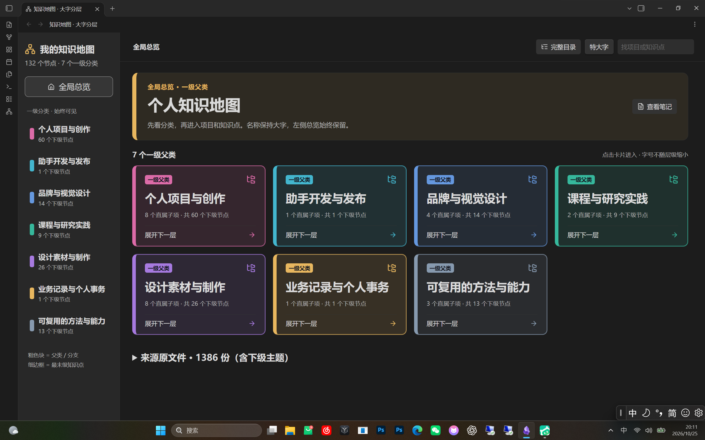
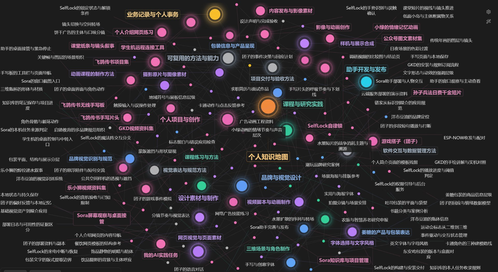
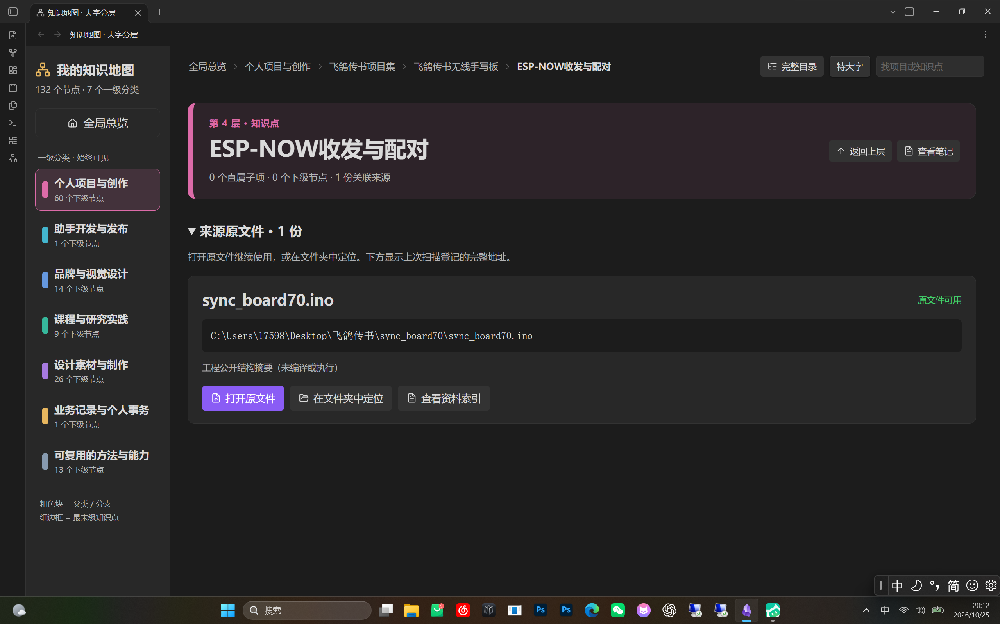
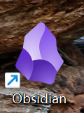

# 🛠️ 保姆级搭建教程：从零复刻这套知识地图

> 全程约 1 小时（一大半在等 Obsidian 安装包下载），不需要编程基础。跟着做，你也会拥有一张能被 AI 查询的知识地图。

## 最终效果（先看再动手）

## 📊 总览仪表盘

### 打开库第一眼：132 个节点、7 个一级分类。点卡片就能一层层往里进，越深的层卡片越小



## 🕸️ 图谱视图

### 所有笔记的关系网，颜色按层级自动分组



## 📂 第 4 层 · 源文件直达

### 知识点笔记里登记真实文件路径，一键定位



---

## 第 1 步 · 下载安装 Obsidian（10~30 分钟，大头是等下载）

1. 打开官网 [obsidian.md](https://obsidian.md)，点 **Get Obsidian for Windows** 下载（Windows 安装包约 330 MB）
2. 下载慢？直接用这条**国内加速直链**复制到浏览器地址栏（实测 20 分钟左右下完）：

   ```
   https://gh-proxy.com/https://github.com/obsidianmd/obsidian-releases/releases/download/v1.14.5/Obsidian-1.14.5.exe
   ```

   上面挂了就换备用：在原链接前加 `https://ghfast.top/`。通用规则：**任何 GitHub 下载链接，前面拼上加速前缀就能直连加速**（版本号旧一点没关系，能装就能用）。

3. 双击安装，一路下一步
4. 装好桌面会出现这个紫色宝石图标：



> 💡 Obsidian 对个人使用**完全免费**，笔记都是本地 `.md` 纯文本，永远不会被锁在软件里。

## 第 2 步 · 下载本仓库的示例库（3 分钟）

1. 打开**本仓库的页面**：浏览器地址栏输入 `github.com/wind-04300/knowledge-map-portfolio`
   （⚠️ 注意：这是"仓库页面"，不是你的 GitHub 个人主页——绿色 Code 按钮只在仓库页面里，个人主页上没有）
2. 点绿色 **Code** 按钮 → **Download ZIP**
3. 解压，找到 `demo-vault` 文件夹（**整个文件夹**都要，包括里面隐藏的 `.obsidian` 配置——画面同款全靠它）
4. 记住这个文件夹的位置

> 🐢 如果 GitHub 下载慢：在 **Download ZIP** 按钮上**右键 → 复制链接**，然后在该链接前面拼上 `https://gh-proxy.com/` 再用浏览器打开，即可加速下载（和第 1 步装 Obsidian 的加速原理相同）。

## 第 3 步 · 用 Obsidian 打开它（30 秒）

1. 打开 Obsidian → 点 **打开本地仓库文件夹**（Open folder as vault）
2. 选中 `demo-vault` 文件夹 → 打开
3. 看到「00-总览」就成功了——绿色主题、图谱分组已经内置，**零配置**

## 第 4 步 · 打开图谱，看懂颜色（1 分钟）

1. 左侧栏点**图谱视图**图标（三个圆连线的那个）
2. 颜色含义：
   - 🟠 **橙色** = 项目（第 2 层）
   - 🟢 **绿色** = 知识点（第 3 层）
   - 🔵 **青色** = 分类（第 1 层）
3. 鼠标悬停任意节点，与它相连的笔记会高亮——这就是「双向链接」的可视化

## 第 5 步 · 理解四层结构（重要，3 分钟）

打开 `00-总览` 顺着链接走一圈，你会发现所有笔记都长在这棵树上：

| 层 | 是什么 | 示例 |
|---|---|---|
| 1 | 分类 | 项目实战 |
| 2 | 项目卡 | 飞鸽传书 |
| 3 | 知识点 | ESP-NOW 双板通信 |
| 4 | 源文件登记 | 真实文件路径表 |

**核心心法：笔记是入口，最后一层永远指向真实文件。** 这样隔一个月回来，从任意笔记 3 次点击内到达源码。

## 第 6 步 · 让 AI 帮你搭你自己的库（推荐主线）

> 🤔 **先解除一个担心**：前面下载的 demo 和这一步要装的 skill **不会冲突**——demo 是个 Obsidian 库文件夹（样板间，给你眼睛看的），skill 是装进 WorkBuddy / Claude 技能目录的一份说明书（给 AI 用的）。一个躺在你的 Obsidian 库列表里，一个躺在 AI 的技能库里，互不搭界，装不装、删不删都不影响对方。**推荐节奏就是：先把 demo 玩满意、想清楚了，再回来装 skill 建自己的库。**

先说清一个关键点：**Obsidian 库的本质就是一堆 `.md` 文件**——AI 能生成文件，就等于能替你建库。你不需要手敲。

### 路线 A · 网页版 ChatGPT（作者亲测，零安装）⭐ 第一次就选这条

**作者的全部知识地图，从头到尾都是在网页版 ChatGPT 里做出来的**——没装插件、没装工具，就靠提示词 + 复制粘贴。这条路被实战验证过，你现在就能开始：

1. 复制 [ai-skill/知识地图搭建提示词.md](../ai-skill/知识地图搭建提示词.md) 发给 ChatGPT
2. 它每生成一篇笔记 → 你复制内容 → 在库文件夹里新建对应 `.md` 文件粘贴
3. 全程 10-20 分钟，不用装任何软件

### 路线 B · WorkBuddy / Claude 等 AI 助手（进阶省力版）

玩熟了想升级，就用能**直接读写硬盘**的 AI 助手——AI 自己往库文件夹里写 `.md`，连复制粘贴都省了：

1. 把本仓库 [ai-skill/SKILL.md](../ai-skill/SKILL.md) 装进智能体的技能目录
2. 对 AI 说一句：**「扫描我的 XX 文件夹，按四层结构搭知识地图」**
3. AI 自动生成分类 → 项目 → 知识点 → 源文件登记，直接写进你指定的库文件夹
4. 用 Obsidian 打开那个文件夹——图谱自己长出来
5. 以后每次干完活，AI 按 skill 里的规矩自动更新地图（越用越聪明）

> **harness 在这里的作用**：WorkBuddy 这类"驾驶舱"让 AI 从会聊天变成能读写文件——它直接往你的库文件夹里写 `.md`，Obsidian 只负责把文件画成图谱。**AI 负责生产，Obsidian 负责展示**，这就是两者结合的全部秘密。

### 怎么选？

- **第一次搭、想立刻开始** → 路线 A（作者的脚印，照着走最稳）
- **打算长期用这套体系** → 先 A 后 B：先用 ChatGPT 把库建起来，尝到甜头再装 skill，让 AI 接管维护
- 两条路的产物一模一样，不存在"哪个才正宗"——**作者现在也在 A、B 之间混着用**。

### 路线 C · 纯手动（选做，5 分钟吃透结构）

不推荐当主线，但手动跑通一次最小模板，你能真正理解四层怎么咬合——以后检查 AI 的产出也心里有数。新建空库照抄：

```markdown
# 分类名

## 项目列表（第 2 层）

- [[你的项目名]]
```

```markdown
# 项目名

> 一句话讲清这是什么。

## 用到的知识点

- [[知识点A]]
- [[知识点B]]
```

```markdown
# 知识点名

## 结论
（只记结论和踩坑，细节放外链）

## 被谁使用
（不用写，反向链接面板自动生成）
```

三条铁律（**AI 建库时也会自动遵守**——它们已写进 skill）：
1. **每条笔记必须有 `[[链接]]`**，不允许孤岛
2. **单个分类超过 ~80 个节点就拆分**，否则总览层会退化成新的混乱
3. **源文件路径变了当场改**，过期路径比没有路径更害人

## 第 7 步 · 日常维护也交给 AI

建好只是开始，完全体是"越用越聪明"。但先分清两件事，别白操心：

| 谁干 | 干什么 | 需要你/我操心吗 |
|---|---|---|
| **Obsidian 自动** | 索引、双链、反向链接、图谱、搜索——文件一改它自己重算 | ❌ 永远不用管，也不用叫 AI 去"扫描" |
| **AI 才要干** | 往库里**写/改 `.md` 的内容**：新项目建档、登记源文件路径、拆分膨胀分类 | ✅ 一句话指挥它 |

所以"让 AI 更新"不是让它去刷新索引，而是让它**生产内容**——Obsidian 发现文件变了，自动把新链接画进图谱。

维护全是嘴里一句话，不用手动：

- 每次干完活：「把这次的新项目补进『项目实战』分类，并更新源文件登记」
- 某个分类太挤：「这个分类超 80 个节点了，帮我拆分」
- 文件挪了位置：「同步更新源文件登记，清掉断链」

> ⚠️ 网页版 ChatGPT 的局限：它**看不到你的硬盘**，没法真的"扫描"或改文件——只能生成内容让你粘贴。真要 AI 直接读写库文件夹，得用 WorkBuddy / Claude 这类 harness。

## 常见问题

**Q：`打开本地仓库文件夹` 找不到我的文件夹？**
弹窗里直接粘贴路径最稳，别一层层点。

**Q：图谱打开是空的？**
说明笔记之间还没有 `[[链接]]`——让 AI「补齐笔记间的双链」，或回第 6 步路线 C 手动补。

**Q：手机上能用吗？**
能，应用商店装 Obsidian App，配合 Remotely Save 插件同步（教程后续更新）。

**Q：我的笔记会被上传到网上吗？**
不会，Obsidian 纯本地。想云备份再用 GitHub 私有仓库（见方法论文档）。

---

✅ 做完了？欢迎在公众号**听风声**晒你的第一张图谱！
